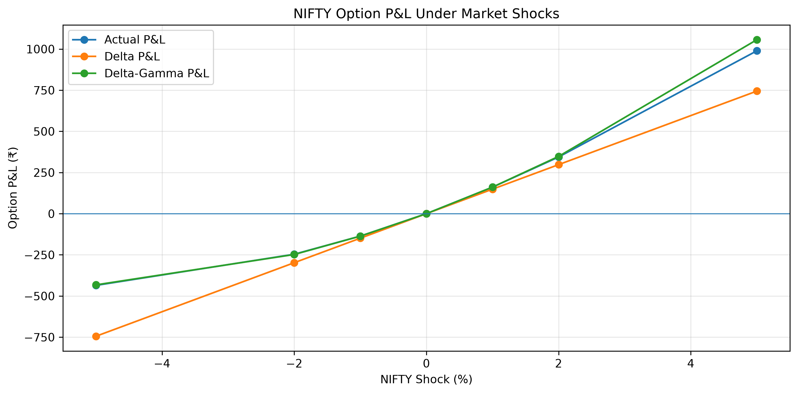
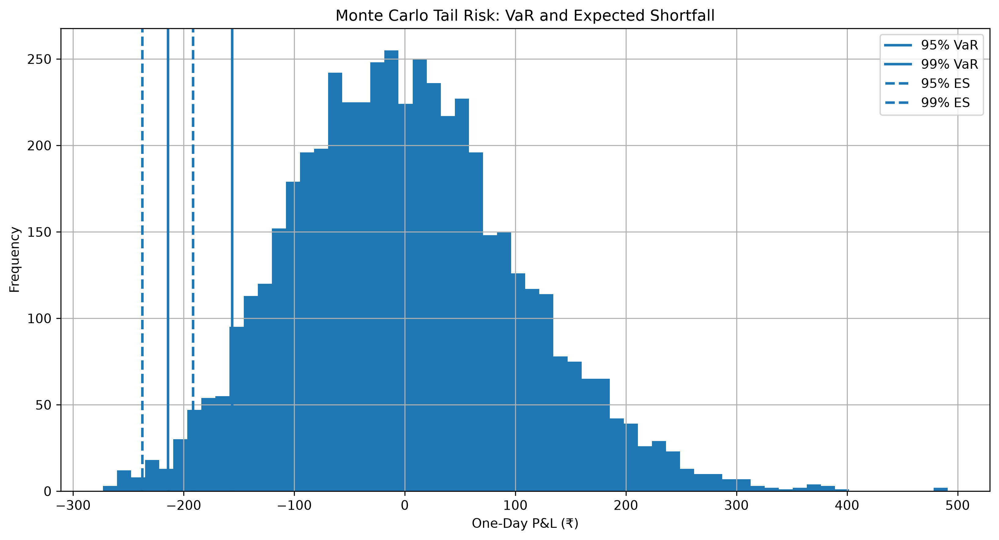
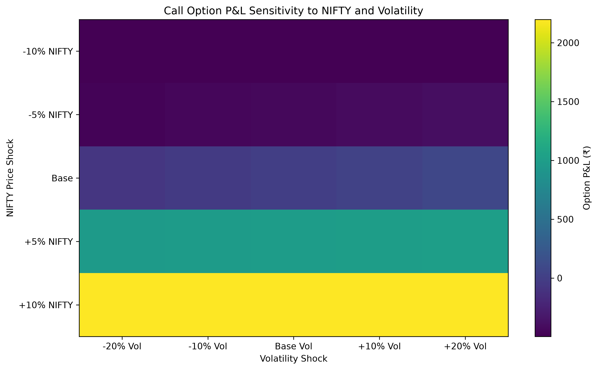
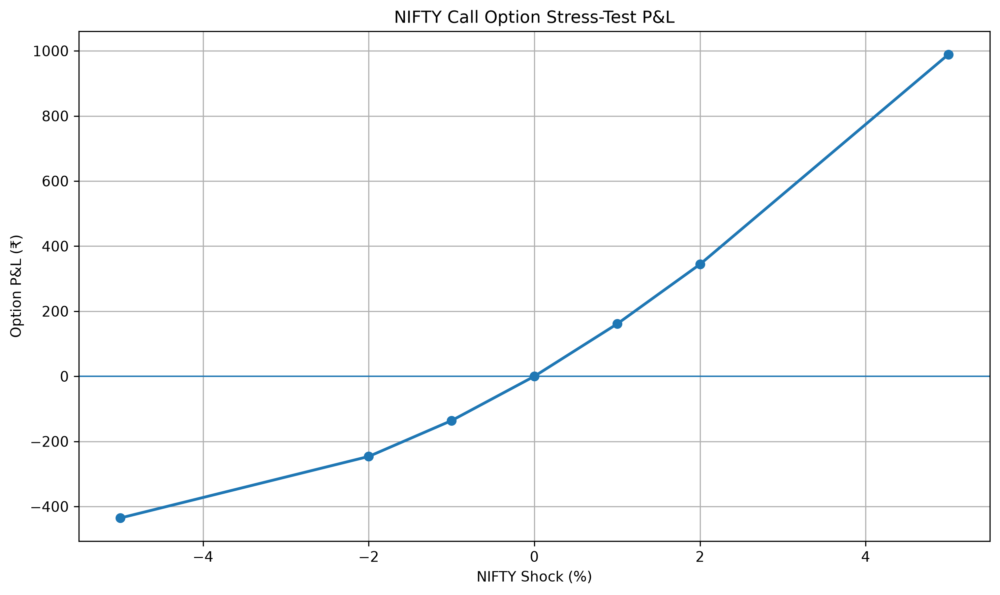
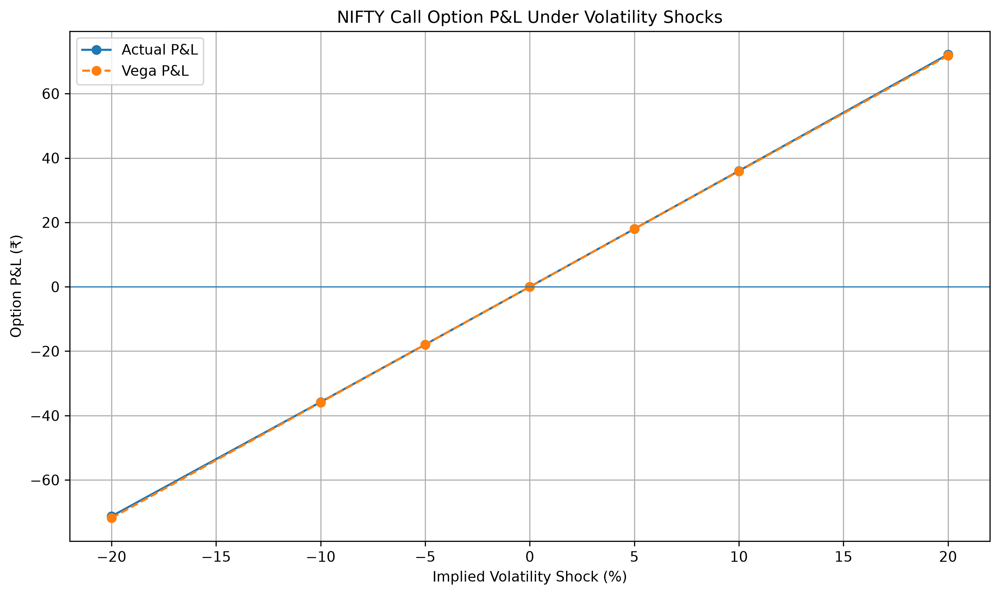

# Options Market Risk & Greeks Engine

A Python-based options market-risk analytics framework developed to value options, analyse Greeks, quantify portfolio risk and evaluate the impact of market shocks on an options portfolio.

The project combines Black-Scholes valuation, historical volatility estimation, option Greeks, scenario analysis, Greeks-based P&L modelling, delta hedging, Monte Carlo simulation, Value at Risk (VaR), Expected Shortfall and stress testing into a consolidated options risk-monitoring framework.

---

## Overview

Options portfolios are exposed to multiple market-risk drivers including:

- Underlying asset price movements
- Implied and realised volatility
- Time decay
- Interest-rate changes
- Non-linear changes in option value

This project develops a quantitative framework to measure and monitor these risks using NIFTY options and market data.

The framework focuses on understanding not only the theoretical value of an option, but also how changes in market variables translate into portfolio P&L and tail risk.

---

## Objectives

- Calculate European option prices using the Black-Scholes model
- Estimate historical volatility from NIFTY market data
- Calculate Delta, Gamma, Vega, Theta and Rho
- Analyse option sensitivity to key market-risk variables
- Construct and analyse an options portfolio
- Perform underlying-price and volatility shock scenarios
- Compare actual option P&L with Delta and Delta-Gamma approximations
- Analyse delta-hedging requirements
- Estimate portfolio VaR and Expected Shortfall
- Perform Monte Carlo simulation for tail-risk analysis
- Perform option stress testing
- Develop a consolidated options market-risk monitoring framework

---

## Methodology

```text
Market Data
     ↓
NIFTY Price & Return Analysis
     ↓
Historical Volatility Estimation
     ↓
Black-Scholes Option Pricing
     ↓
Option Greeks
     ↓
Market Variable Scenario Analysis
     ↓
Greeks-Based P&L
     ↓
Delta Hedging
     ↓
Monte Carlo Simulation
     ↓
VaR & Expected Shortfall
     ↓
Option Stress Testing
     ↓
Risk Monitoring & Interpretation

---
---

## Analysis & Visualizations

### Delta-Gamma P&L

The Delta-Gamma P&L analysis compares actual option portfolio P&L with the approximation based on Delta and Gamma exposures.



---

### Monte Carlo Tail Risk

Monte Carlo simulation is used to model the distribution of portfolio outcomes and identify extreme tail losses.



---

### Option Risk Heatmap

The heatmap illustrates how option portfolio risk changes across combinations of underlying price and volatility.



---

### Option Stress Testing

Stress scenarios are applied to key market-risk variables to evaluate potential losses under adverse market conditions.



---

### Vega Risk Analysis

Vega exposure is analysed to understand the sensitivity of the option portfolio to changes in implied volatility.


---

## Key Risk Measures

The framework incorporates:

- Option Greeks: Delta, Gamma, Vega, Theta and Rho
- Implied volatility analysis
- Greeks-based P&L attribution
- Delta hedging analysis
- Monte Carlo simulation
- Value at Risk (VaR)
- Expected Shortfall (ES)
- Option stress testing
- Portfolio risk monitoring

## Risk Management Interpretation

The project demonstrates how option Greeks can be converted from theoretical sensitivity measures into practical market-risk monitoring indicators. The framework combines scenario analysis, simulation-based tail-risk measures and Greeks-based exposure analysis to support portfolio risk assessment and hedging decisions.

## Key Risk Outputs

The framework produces the following market-risk outputs:

- Black-Scholes call and put valuations for NIFTY options
- Option Greeks including Delta, Gamma, Vega, Theta and Rho
- Implied volatility estimation
- Greeks-based P&L and sensitivity analysis
- Delta and Delta-Gamma P&L approximations
- Monte Carlo simulation of option portfolio losses
- Historical Value at Risk (VaR)
- Expected Shortfall (ES)
- Underlying-price and volatility stress testing
- Greeks-based risk monitoring and interpretation

---

## Risk Management Applications

The project demonstrates how quantitative derivatives models can be used for practical market-risk management.

Key applications include:

- Monitoring sensitivity to underlying-price movements
- Measuring volatility-driven option risk
- Identifying major Greek risk exposures
- Estimating potential tail losses using VaR and Expected Shortfall
- Evaluating portfolio behaviour under adverse market scenarios
- Assessing delta-hedging requirements
- Comparing actual P&L with risk-model approximations
- Supporting risk-limit and exposure monitoring

---

## Visual Risk Analysis

### Delta-Gamma P&L


### Vega Risk


### Option Risk Heatmap


### Monte Carlo Tail Risk


### Stress Testing


---

## Technology Stack

- Python
- NumPy
- Pandas
- SciPy
- Matplotlib
- Seaborn
- yfinance
- Jupyter Notebook

---

## Project Structure

```text
options-market-risk-greeks-engine/
│
├── Options_Market_Risk_Greeks_Engine.ipynb
├── README.md
├── requirements.txt
│
├── delta_gamma_pnl.png
├── monte_carlo_tail_risk.png
├── option_risk_heatmap.png
├── stress_testing.png
└── vega_risk.png
