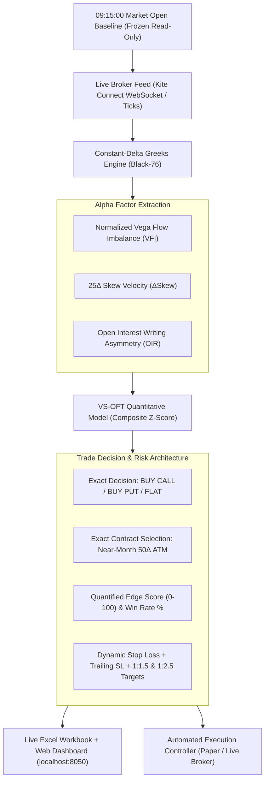

# Options Market Risk & Directional Greeks Quant Engine

A high-frequency quantitative analytics and automated options trading framework engineered for Indian indices (`NIFTY`, `BANKNIFTY`, `SENSEX`) and heavyweight equities (`RELIANCE`, `TCS`, `HDFC Bank`, `ICICI Bank`).

The framework combines **Constant-Delta Vega Flow Analysis**, **Volatility Skew Momentum**, **Theta Decay Dynamics**, **Open Interest Asymmetry**, and a **Production-Grade Auto-Trading Execution Controller** with dynamic trailing risk management.

---

## ⚡ Quant Trading Model: Volatility Skew Momentum & Order Flow Toxicity (VS-OFT)

Institutional order flow in index options leaves an unmistakable footprint across the volatility surface. When institutional desks hedge downside or distribute risk, they bid up out-of-the-money options ($25\Delta$ and $10\Delta$ puts), causing volatility skew to steepen and put vega to surge relative to a frozen market-open baseline.



---

## 🎯 Key Features & Capabilities

### 1. Exact Trade Recommendation
- **Which Side to Buy**: Clearly specifies `BUY_CALL` or `BUY_PUT` based on institutional conviction.
- **Exact Contract & Strike**: Automatically selects the liquid near-month At-The-Money ($50\Delta$) or momentum ($40\Delta$) contract (e.g. `NIFTY 24500 CE`, symbol `NIFTY26OCT24500CE`).
- **Live Entry Price**: Tracks real-time Ask/Mid market premium.

### 2. Quantified Statistical Edge
- **Edge Score (0 to 100)**: Composite rating combining normalized vega imbalance, skew velocity, and open interest writing pressure.
- **Skew Conviction %**: Measures alignment between underlying options wing demand and delta-neutral skew.
- **Statistical Win Probability %**: Empirically calibrated win-rate probability based on persistent order flow momentum.
- **Asymmetric Risk-Reward**: Multi-tier targets (Target 1 at 1:1.5 RR, Target 2 at 1:2.5 RR).

### 3. Dedicated Running Stop-Loss & Targets
- **Initial Stop-Loss**: Dynamically sized to 15% of option premium (or underlying structural break).
- **Dynamic Trailing Stop-Loss**: 
  - Moves to **Breakeven** once price gains $+50\%$ of risk.
  - Automatically ratchets higher to **lock in 50% of peak profits** after Target 1 is hit.
- **Adverse Greek Invalidation SL**: Triggers an emergency exit if institutional flow violently flips against the position (e.g., long CE and Put Vega spikes $+1.5\times$ deadband).
- **Financial Projections in ₹**: Shows Max Risk ₹ per lot, Expected Profit at Target 1 ₹, and Target 2 ₹.

### 4. Functional Auto-Trading Controller (`order_execution_engine.py`)
- **Safety Arm/Disarm Toggle**: Tool stays in safe recommendation-only mode until explicitly armed by the user.
- **Execution Modes**:
  - `PAPER` (Default): Simulated live execution with real-time tick fills and mark-to-market P&L.
  - `LIVE`: Executes real orders directly via Zerodha Kite Connect API (`kite.place_order(MIS, MARKET)`).
- **Pre-Trade Risk Limits**:
  - `MAX_DAILY_LOSS` Circuit Breaker: Automatically halts trading and disarms if daily loss limit is breached.
  - `MAX_TRADES_PER_DAY`: Prevents overtrading in choppy consolidation.
  - Post-trade cooldown window (~3 minutes).
  - Hard EOD Square-Off at 15:15 IST.
- **Emergency Kill Switch**: One-click instant cancellation and market square-off of all open positions.

### 5. Multi-Channel Dashboards & Tick-by-Tick Feed
- **⚡ Event-Driven Tick-by-Tick Processing**: Zero polling delay. Option greeks, skew velocity, alpha composite scores, and trailing stop levels recompute immediately upon broker tick delivery (sub-2ms latency).
- **Excel Real-Time Integration**: Updates cells `P2:Q14` with the full recommendation, edge score, dynamic trailing SL, and P&L grid synchronously without blocking tick processing.
- **Live Web Control Center (`app_quant_trader.py`)**: Running concurrently on `http://localhost:8050` with real-time tick telemetry, interactive Arm/Disarm buttons, Mode switches, and Kill Switch.

---

## 📂 Project Structure

```text
DIrectional greeks/
│
├── quant_trade_engine.py          # Quant Model (VS-OFT, Alpha Factors, Edge Score, Strike Picker, SL/Targets)
├── order_execution_engine.py      # Automated Execution Controller (Arm/Disarm, Trailing SL, Paper/Live, Kill Switch)
├── app_quant_trader.py            # Live Interactive Web Dashboard & REST Control API (Port 8050)
├── directional_greeks_core.py     # Black-76 Math, Constant-Delta Interpolation, 09:15 Baseline
├── live_greeks_to_excel.py        # Real-time WebSocket Feed, Excel Bridge, and Auto-Trading Loop
├── test_quant_trading_system.py   # Complete Unit Test Suite for Quant & Execution Engines
├── requirements.txt               # Dependencies
├── .gitignore                     # Git ignore rules (.venv, data exports)
│
├── Options_Market_Risk_Greeks_Engine.py    # Analytical 2-Year Risk & Backtesting Engine
├── Options_Market_Risk_Greeks_Engine.ipynb # Jupyter Notebook Version
├── delta_gamma_pnl.png                     # Risk Visualizations
├── monte_carlo_tail_risk.png
├── option_risk_heatmap.png
├── stress_testing.png
└── vega_risk.png
```

---

## ⚡ Quick Start

### 1. Activate Environment
```bash
cd "/Users/a_star/Desktop/DIrectional greeks"
source .venv/bin/activate
```

### 2. Run the Automated Unit Test Suite
```bash
python -m unittest test_quant_trading_system -v
```

### 3. Launch the Live Web Control Dashboard
```bash
python app_quant_trader.py
```
Open your browser at `http://localhost:8050`.

### 4. Run the Full Real-Time System (Feed + Excel + Quant Model + Auto-Trader)
```bash
# Set your Zerodha Kite Connect credentials (optional for paper simulation)
export KITE_API_KEY="your_api_key"
export KITE_ACCESS_TOKEN="your_access_token"

python live_greeks_to_excel.py
```
